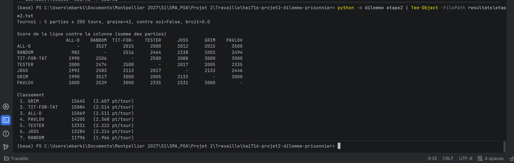
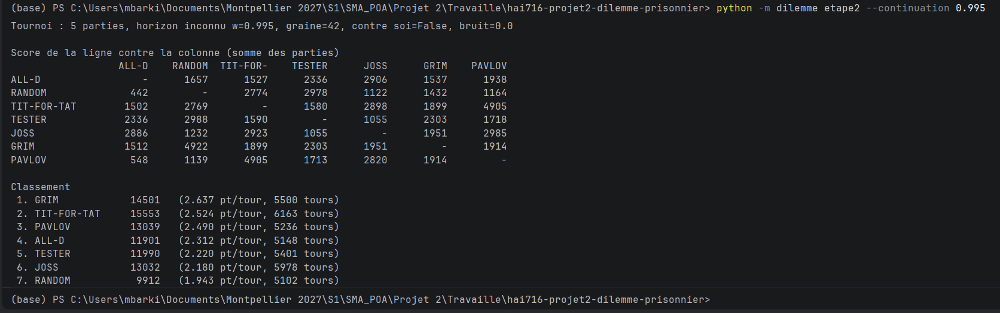

# Journal de bord

## Informations générales

- Module : HAI716
- Projet : tournoi du dilemme du prisonnier itéré
- Auteur : Mohammed M'BARKI
- Langage envisagé : Python
- Date de début : 13 novembre 2026

---

## 1. Protocole

| Paramètre | Valeur | Justification |
|---|---|---|
| Tours par partie | 200 | format imposé par l'énoncé |
| Parties par paire | 5 | format imposé par l'énoncé |
| Gains CC, CD, DC, DD | (3,3), (0,5), (5,0), (2,2) | matrice du cours |
| Graine | 42 | obtenir des résultats reproductibles |
| Contre son double | non par défaut | l'énoncé demande d'affronter chaque autre stratégie |
| Modifications | bruit 5 % et horizon inconnu | bruit réalisé par MESTI ; horizon inconnu pour ma partie |

Le moteur, les stratégies du cours et le tournoi ont été développés par
MESTI. J'ai récupéré cette base, relu les fichiers et relancé les tests : les
9 tests présents passent. J'ai aussi reproduit les classements sans bruit et
avec un bruit de 5 %.

## 2. Compréhension de la population de base

| Stratégie | Règle et origine | Matchups favorables | Matchups défavorables |
|---|---|---|---|
| ALL-D | Stratégie de référence du cours ; joue toujours D. | Exploite les stratégies qui continuent à coopérer. | Obtient seulement 2 points par tour contre elle-même et ne profite pas des coopérations durables. |
| RANDOM | Témoin aléatoire du cours ; choisit C ou D avec la même probabilité. | Son imprévisibilité peut gêner les stratégies qui cherchent un motif. | ALL-D l'exploite et une première trahison déclenche la punition de GRIM. |
| TIT-FOR-TAT | Stratégie d'Anatol Rapoport présentée dans le cours ; commence par C puis copie le dernier coup adverse. | Coopère durablement avec les stratégies gentilles et réciproques. | Subit la première trahison et peut entrer dans des représailles avec une stratégie agressive ou bruitée. |
| TESTER | Stratégie du cours ; commence par D, passe à TIT-FOR-TAT si l'adversaire riposte, sinon répète C, C, D. | Repère et exploite un adversaire qui ne punit pas. | Une stratégie punitive répond à son premier D et empêche cette exploitation. |
| JOSS | Variante probabiliste de TIT-FOR-TAT présentée dans le cours ; remplace parfois C par D avec une probabilité de 10 %. | Profite parfois d'un coopérateur grâce à ses trahisons ponctuelles. | Ses trahisons déclenchent des représailles, en particulier la punition définitive de GRIM. |

Avec la population de base et sans confrontation contre soi, ALL-D termine
premier et TIT-FOR-TAT deuxième. Ce résultat diffère du tournoi historique
d'Axelrod parce que la population est ici très petite et contient peu de
stratégies capables de maintenir une coopération durable.

## 3. Étape 2 - nouvelles stratégies

### GRIM

GRIM commence par coopérer. Elle continue tant que l'adversaire n'a jamais
trahi. Dès qu'un D apparaît dans l'historique adverse, elle joue D jusqu'à la
fin de la partie. C'est une stratégie de déclenchement classique des jeux
répétés, souvent associée aux travaux de James Friedman sur les superjeux
(1971).

Source : https://doi.org/10.2307/2296617

Attentes avant le tournoi :

- elle devrait coopérer parfaitement avec TIT-FOR-TAT et avec elle-même ;
- elle devrait limiter rapidement les gains d'ALL-D après avoir subi une
  première exploitation ;
- elle devrait mal réagir aux trahisons occasionnelles de JOSS, car elle ne
  pardonne jamais.

### PAVLOV

PAVLOV, ou Win-Stay Lose-Shift, commence par C. Après CC ou DD, elle joue C ;
après CD ou DC, elle joue D. Elle peut donc retrouver la coopération après
une trahison mutuelle. Nowak et Sigmund ont étudié cette stratégie dans le
dilemme du prisonnier en 1993.

Source : https://doi.org/10.1038/364056a0

Attentes avant le tournoi :

- elle devrait coopérer durablement avec TIT-FOR-TAT et avec elle-même ;
- elle devrait mieux récupérer que TIT-FOR-TAT après une séquence DD ;
- elle devrait être exploitée par ALL-D pendant un tour sur deux, car elle
  revient à C après chaque DD ;
- son comportement contre RANDOM devrait être irrégulier.

Le classement de l'étape 2 n'avait pas encore été lancé au moment où ces
attentes ont été écrites et commitées.

### Résultats du tournoi élargi

Commande : `python -m dilemme etape2`

| Rang | Stratégie | Score | Moyenne par tour |
|---:|---|---:|---:|
| 1 | GRIM | 15645 | 2,607 |
| 2 | TIT-FOR-TAT | 15084 | 2,514 |
| 3 | ALL-D | 15069 | 2,511 |
| 4 | PAVLOV | 14205 | 2,368 |
| 5 | TESTER | 13331 | 2,222 |
| 6 | JOSS | 13284 | 2,214 |
| 7 | RANDOM | 11796 | 1,966 |

La sortie complète est conservée dans `resultats/etape2.txt`.

### Comparaison avec l'étape 1

Dans la population de base, ALL-D était première et TIT-FOR-TAT deuxième.
Après l'ajout de GRIM et PAVLOV, GRIM termine première, TIT-FOR-TAT reste
deuxième et ALL-D descend à la troisième place. Les scores totaux des deux
tournois ne sont pas directement comparables, car chaque stratégie rencontre
deux adversaires supplémentaires à l'étape 2. Les rangs et les moyennes par
tour sont donc plus utiles pour l'analyse.

GRIM obtient 3000 points contre TIT-FOR-TAT et 3000 contre PAVLOV : les trois
stratégies maintiennent la coopération pendant les cinq parties. Contre
ALL-D, GRIM marque 1990 points et ALL-D 2015. Elle subit la première trahison,
puis répond par D jusqu'à la fin, ce qui limite l'exploitation. Contre JOSS,
GRIM ne marque que 2133 points : une trahison occasionnelle de JOSS suffit à
déclencher une punition définitive. Ces observations correspondent aux
attentes écrites avant le tournoi.

PAVLOV coopère parfaitement avec TIT-FOR-TAT et GRIM, avec 3000 points dans
chaque confrontation. En revanche, elle ne marque que 1000 points contre
ALL-D, qui en obtient 3500. Leur partie alterne entre CD et DD : après DD,
PAVLOV revient à C et se fait de nouveau exploiter. Cette faiblesse explique
sa quatrième place malgré ses bonnes coopérations.

L'arrivée de deux stratégies coopératives profite également à TIT-FOR-TAT,
qui obtient 3000 points contre chacune. Le passage d'ALL-D de la première à
la troisième place confirme que le vainqueur dépend fortement de la
population du tournoi.

Les 11 tests passent après l'ajout des deux stratégies.

## 4. Étape 3 - horizon inconnu

### Choix du paramètre

Après chaque tour, la partie continuera avec une probabilité `w = 0,995` et
s'arrêtera avec une probabilité `1 - w = 0,005`. Une partie comportera donc
toujours au moins un tour, mais sa longueur ne sera plus connue à l'avance.

J'ai choisi cette valeur pour conserver une durée moyenne comparable aux 200
tours du tournoi de base :

`1 / (1 - 0,995) = 200` tours en moyenne.

Les parties pourront malgré tout être beaucoup plus courtes ou plus longues
que 200 tours. La graine 42 sera conservée pour retrouver les mêmes durées et
les mêmes résultats lors d'une nouvelle exécution.

Comme les stratégies risquent de ne pas jouer exactement le même nombre de
tours au total, le classement devra utiliser la moyenne de points par tour.
Les scores totaux seront conservés dans la sortie, mais ils ne suffiront pas
pour comparer équitablement les stratégies.

### Prédictions avant l'expérience

- GRIM, TIT-FOR-TAT et PAVLOV devraient rester fortes lorsqu'elles se
  rencontrent, car elles peuvent conserver une coopération à 3 points par
  tour quelle que soit la longueur de la partie.
- Les parties très courtes devraient parfois favoriser ALL-D et TESTER. Leur
  première trahison pèsera davantage si la partie s'arrête avant que
  l'adversaire ait le temps de réagir.
- TIT-FOR-TAT et GRIM devraient rester proches du haut du classement, mais
  l'ordre exact pourrait changer à cause des durées variables.
- PAVLOV devrait rester pénalisée contre ALL-D, qui l'exploite un tour sur
  deux.
- Les différences avec l'étape 2 devraient rester modérées, puisque la durée
  moyenne choisie reste égale à 200 tours.

Cette prédiction est écrite avant la modification du moteur et avant le
premier lancement du tournoi à horizon inconnu.

### Résultats à horizon inconnu

Commande : `python -m dilemme etape2 --continuation 0.995`

| Rang | Stratégie | Score total | Moyenne par tour | Tours joués |
|---:|---|---:|---:|---:|
| 1 | GRIM | 14501 | 2,637 | 5500 |
| 2 | TIT-FOR-TAT | 15553 | 2,524 | 6163 |
| 3 | PAVLOV | 13039 | 2,490 | 5236 |
| 4 | ALL-D | 11901 | 2,312 | 5148 |
| 5 | TESTER | 11990 | 2,220 | 5401 |
| 6 | JOSS | 13032 | 2,180 | 5978 |
| 7 | RANDOM | 9912 | 1,943 | 5102 |

La sortie complète est conservée dans
`resultats/horizon_inconnu.txt`.

Le classement utilise bien la moyenne par tour. Le score total ne serait pas
équitable ici : par exemple, TIT-FOR-TAT a joué 6163 tours contre 5148 pour
ALL-D. Cela explique aussi pourquoi GRIM est classée première malgré un score
total inférieur à celui de TIT-FOR-TAT.

GRIM et TIT-FOR-TAT restent aux deux premières places, comme prévu. Les
rencontres coopératives conservent une moyenne de 3 points par tour :
TIT-FOR-TAT contre PAVLOV dure 1635 tours, et GRIM contre PAVLOV 638 tours.
La longueur variable ne détruit donc pas leur coopération.

En revanche, l'idée que les parties courtes avantageraient globalement ALL-D
et TESTER n'est pas confirmée. PAVLOV monte de la quatrième à la troisième
place et ALL-D descend de la troisième à la quatrième. Les durées tirées au
sort n'ont pas le même poids selon les adversaires : la rencontre très
favorable à ALL-D contre PAVLOV ne dure que 552 tours, tandis que ses
rencontres proches de 2 points par tour contre JOSS et TESTER durent
respectivement 1447 et 1168 tours. Ce tirage réduit sa moyenne générale.

PAVLOV reste bien vulnérable à ALL-D : elle n'obtient que 548 points contre
1938, car elle revient à C après chaque DD. Sa troisième place vient surtout
de ses longues coopérations avec TIT-FOR-TAT et des autres confrontations de
ce tirage. Les écarts avec l'étape 2 restent donc limités, mais les rangs
intermédiaires changent à cause des durées variables.

Les 15 tests passent après l'ajout de l'horizon inconnu, notamment les tests
de reproductibilité, de validation de `w` et de classement par moyenne.

## 5. Impasses et corrections

- Sous PowerShell, la première redirection de la sortie de l'étape 2 avait
  produit un fichier UTF-16. Je l'ai converti en UTF-8 pour qu'il soit lisible
  de la même façon sur les différentes plateformes.
- Avec des parties de longueurs différentes, le classement initial par score
  total favorisait les stratégies ayant joué davantage de tours. J'ai donc
  compté les tours réellement joués et utilisé les points par tour pour le
  classement à horizon inconnu.

Le tournoi de base, le tournoi élargi et l'expérience à horizon inconnu sont
reproductibles avec la graine 42. Les commandes nécessaires figurent dans le
README.
