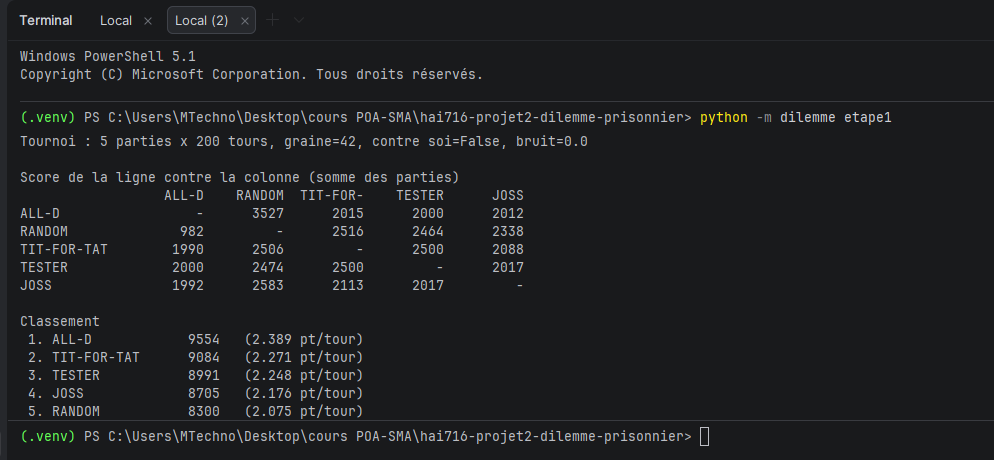
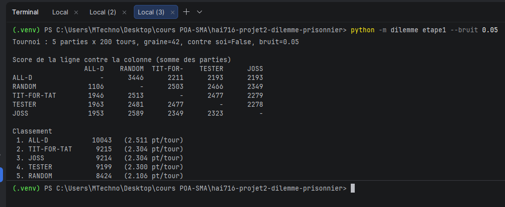

# Journal de bord

## Informations générales

- Module : HAI716
- Projet : tournoi du dilemme du prisonnier itéré
- Auteur : Mohamed Mesti
- Langage envisagé : Python
- Date de début : 13 novembre 2026

---

## 1. Protocole

| Paramètre | Valeur | Raison du choix |
|---|---|---|
| Tours par partie | 200 | format d'Axelrod du cours |
| Parties par paire | 5 | format d'Axelrod du cours |
| Gains (CC, CD, DC, DD) | (3,3), (0,5), (5,0), (2,2) | matrice imposée par l'énoncé |
| Graine | 42 | fixée pour rejouer le tournoi à l'identique |
| Contre son double | non (par défaut) | l'énoncé dit « chaque stratégie affronte chaque autre » ; testé aussi avec `--contre-soi` |
| Modifications (étape 3) | bruit 5 % (moi) + sélection (M’BARKI) | regarde ce que les trahisons de JOSS font à TFT |

Reproductibilité : chaque partie a son propre générateur aléatoire, dérivé de
(graine, paire de stratégies, numéro de partie). Ajouter une stratégie ne
change donc pas les tirages des autres paires.

---

## 2. Stratégies

### Population de base (cours 4)

| Stratégie | Règle | Origine | Devrait bien jouer contre | Devrait mal jouer contre |
|---|---|---|---|---|
| ALL-D | toujours D | stratégie « rationnelle » par récurrence à rebours | les naïfs, RANDOM | elle-même, TFT (gain 2 au lieu de 3) |
| RANDOM | C ou D à 50 % | témoin | TFT (2516) : TFT lui renvoie ses C | ALL-D (982) : ses C sont exploités, gain 0 |
| TIT-FOR-TAT | C au tour 1, puis copie le dernier coup adverse | Rapoport, vainqueur d'Axelrod 1980 | les gentils, elle-même (3000) : coopération à 3 par tour | ALL-D (1990) : perd le 1er tour ; JOSS (2088) : représailles en écho |
| TESTER | D au tour 1 ; si l'adversaire riposte → TFT, sinon cycle C, C, D | cours 4 | les naïfs qui ne ripostent pas (exploités par le cycle) ; TFT (2500) | ALL-D (2000) et JOSS (2017) : trahisons mutuelles |
| JOSS | TFT, mais remplace C par D une fois sur dix | cours 4 | RANDOM (2583) : ses trahisons surprises rapportent 5 | ALL-D (1992) ; TESTER (2017) : ses trahisons déclenchent des représailles |

**Choix d'interprétation pour TESTER** : le cours ne dit pas quand on vérifie
la riposte. J'ai retenu : dès que l'adversaire joue D une fois, TESTER passe
définitivement en TIT-FOR-TAT ; sinon il enchaîne C, C, D à partir du tour 2.

### Nouvelles stratégies (étape 2)

Partie réalisée par Mohammed M'BARKI (voir son journal et sa branche `mbarki`).

---

## 3. Étape 1 — tournoi de base

Commande : `python -m dilemme etape1`

Sortie (graine 42, fichier `resultats/etape1.txt`) :

```
Score de la ligne contre la colonne (somme des parties)
                  ALL-D    RANDOM  TIT-FOR-    TESTER      JOSS
ALL-D                 -      3527      2015      2000      2012
RANDOM              982         -      2516      2464      2338
TIT-FOR-TAT        1990      2506         -      2500      2088
TESTER             2000      2474      2500         -      2017
JOSS               1992      2583      2113      2017         -

Classement
 1. ALL-D            9554   (2.389 pt/tour)
 2. TIT-FOR-TAT      9084   (2.271 pt/tour)
 3. TESTER           8991   (2.248 pt/tour)
 4. JOSS             8705   (2.176 pt/tour)
 5. RANDOM           8300   (2.075 pt/tour)
```

Avec les graines 1, 2 et 3 : ALL-D reste 1er, TESTER et TFT s'échangent les places 2 et 3.

Variante `--contre-soi` (fichier `resultats/etape1_contre_soi.txt`) :
TIT-FOR-TAT passe 1er (12084) devant ALL-D (11554).
Matchs contre son double : TFT/TFT = 3000, ALL-D/ALL-D = 2000,
TESTER/TESTER = 2000, JOSS/JOSS = 2037, RANDOM/RANDOM = 2574.

Tests unitaires : `python -m unittest -v` → 7 tests OK.



### Question : TIT-FOR-TAT gagne-t-il ?

Non. Le classement montre que ALL-D est le gagnant (9554 points) et que TFT
est au 2e rang (9084 points).

ALL-D marque le plus contre RANDOM (3527 points, environ 3,5 points par tour).

TFT ne coopère pas vraiment avec TESTER et JOSS : 2500 et 2088 points, soit
moins de 3 points par tour.

Quand chaque stratégie joue aussi contre elle-même (`--contre-soi`), TFT
gagne : TFT contre TFT = 3000, ALL-D contre ALL-D = 2000, donc TFT passe à
12084 et ALL-D à 11554.

En 1980, il y avait 15 participants, dont beaucoup de stratégies gentilles.
Dans mon tournoi, il n'y a que 5 stratégies, et seulement une est gentille :
TIT-FOR-TAT. TFT n'a donc aucune autre stratégie avec qui coopérer, alors
qu'en 1980 il en avait beaucoup. C'est pour ça qu'ALL-D gagne chez moi.

---

## 4. Étape 2 — nouvelles stratégies

Partie réalisée par Mohammed M'BARKI (voir son journal et sa branche `mbarki`).

---

## 5. Étape 3 — modifications du tournoi

Pour chaque modification : prédiction écrite **avant** de lancer, puis résultat, puis explication de l'écart.

### Modification 1 : bruit (5 %)

Commande : `python -m dilemme etape1 --bruit 0.05`

- Justification du choix : vérifier si une erreur de coup casse la
  coopération de TFT, comme le montre le cours 4 (diapositive « le bruit »).
- Prédiction (avant exécution) :
  - TFT contre TFT : après une erreur, les deux se punissent en boucle.
  - ALL-D est un peu gêné : quand son D devient C il gagne moins, mais les
    erreurs des autres lui donnent parfois 5.
  - RANDOM ne change pas beaucoup : il joue déjà au hasard.
  - Classement : l'écart entre ALL-D et TFT va grandir, ALL-D reste 1er.
- Résultat (fichiers `resultats/bruit.txt` et `resultats/bruit_contre_soi.txt`) :

  | | Sans bruit | Bruit 5 % | Bruit 5 % + contre-soi |
  |---|---|---|---|
  | ALL-D | 9554 (1er) | 10043 (1er) | 12074 (1er) |
  | TIT-FOR-TAT | 9084 (2e) | 9215 (2e) | 11664 (2e) |
  | JOSS | 8705 (4e) | 9214 (3e) | 11491 (4e) |
  | TESTER | 8991 (3e) | 9199 (4e) | 11609 (3e) |
  | RANDOM | 8300 (5e) | 8424 (5e) | 10990 (5e) |

  TFT contre TFT : 3000 sans bruit, 2449 avec bruit.

  

- Écart et explication :
  - Juste : l'écart ALL-D / TFT grandit (470 → 828) et ALL-D reste 1er.
  - Juste : TFT contre TFT se punissent en boucle, ils perdent 551 points
    (3000 → 2449). Du coup, avec `--contre-soi`, TFT ne passe plus 1er
    comme sans bruit : c'est ALL-D qui gagne.
  - Juste : RANDOM change peu.
  - Faux : ALL-D n'est pas gêné, il gagne +489 points. Quand ALL-D joue C par
    erreur, TFT copie ce C au tour suivant et ALL-D marque 5 (0 + 5 au lieu
    de 2 + 2). Les erreurs de TFT lui donnent aussi des 5.
  - Avec le bruit, TFT trahit au hasard comme JOSS : leurs scores deviennent
    presque égaux (9215 et 9214).

### Modification 2

Partie réalisée par Mohammed M'BARKI (voir son journal et sa branche `mbarki`).

---

## 6. Impasses

- La découverte des tests (`python -m unittest discover -s tests`) échouait :
  le dossier `tests` n'était pas un paquet. Ajout de `tests/__init__.py`.
